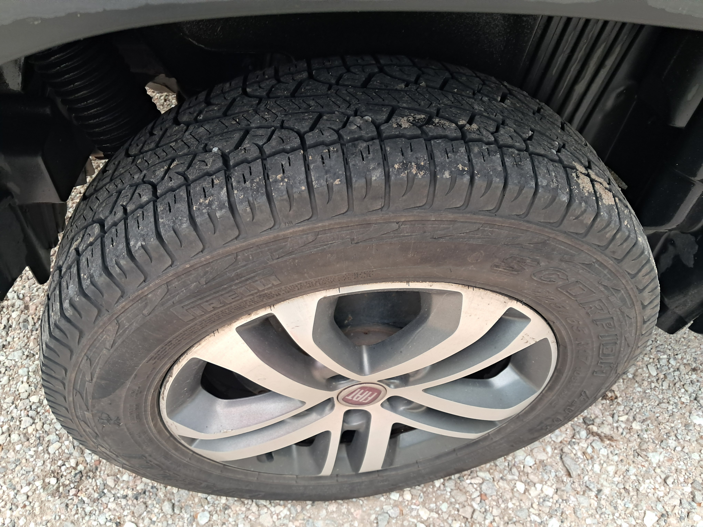

# demo en quarto tp opcional
JPC
2026-10-01

# Figura creada con código de R

``` r
library(ggplot2)
```

    Warning: package 'ggplot2' was built under R version 4.6.1

``` r
ggplot(cars, aes(x = speed, y = dist)) +
  geom_point(color = "darkcyan", size = 3, alpha = 0.7) +
  geom_smooth(method = "lm", color = "coral", se = FALSE) +
  labs(title = "Velocidad vs Distancia de Frenado",
       x = "Velocidad (mph)",
       y = "Distancia (ft)") +
  theme_minimal()
```


# Figura a partir de un archivo de imagen externo



# Texto con sintaxis Markdown (negrita y cursiva)

***La rueda que figura en la imagen anterior corresponde a una fiat
toro***

# Escritura matemática

La famosa ecuación de Einstein es $E = mc^2$, la cual relaciona masa y
energía.

# Listas

**Lista ordenada:** 1. Primer paso 2. Segundo paso 3. Tercer paso

# Tabla creada con sintaxis Markdown

| Producto | Cantidad | Precio Unitario |
|----------|:--------:|----------------:|
| Laptop   |    5     |       \$800 USD |
| Mouse    |    12    |        \$25 USD |
| Teclado  |    8     |        \$45 USD |

# Tabla creada con código de R

``` r
library(knitr)
```

    Warning: package 'knitr' was built under R version 4.6.1

``` r
datos <- data.frame(
  País = c("Argentina", "Chile", "Perú"),
  Población_Millones = c(46.2, 19.6, 34.3)
)
kable(datos, caption = "Tabla generada con código de R")
```

| País      | Población_Millones |
|:----------|-------------------:|
| Argentina |               46.2 |
| Chile     |               19.6 |
| Perú      |               34.3 |

Tabla generada con código de R

# Bloques de código ocultos y visibles.

``` r
resultado <- 5 + 5
print(resultado)
```

    [1] 10

    Este texto proviene de un bloque de código cuyo origen está oculto.
